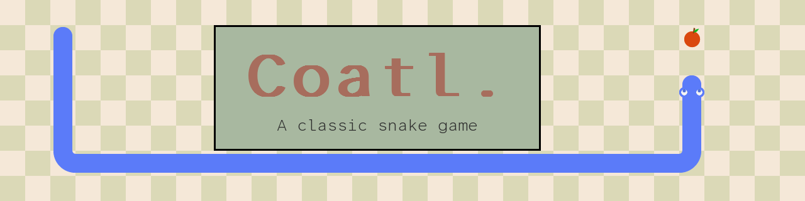

[](https://github.com/landoicco/coatl/actions/workflows/build.yml)
[](https://www.python.org/downloads/)
[](LICENSE)

A classic **Snake** arcade game built with Python and Pygame-CE, with music, sound effects and start / game over screens.

> **Coatl** is the Nahuatl word for *snake* ([Gran Diccionario Náhuatl](https://gdn.iib.unam.mx/diccionario/coatl/111897)).

## 📦 Download

Get the binary for your OS from the [latest release](https://github.com/landoicco/coatl/releases/latest), or from the [rolling build](https://github.com/landoicco/coatl/releases/tag/latest) of `master`. No Python needed.

| OS | File | Notes |
| --- | --- | --- |
| Linux | `coatl-linux` | Run `chmod +x coatl-linux` first |
| macOS (Apple Silicon) | `coatl-macos.zip` | Unzip, then right-click `coatl-macos.app` → **Open** the first time (the app is not signed) |
| Windows | `coatl-windows.exe` | If SmartScreen warns, click **More info** → **Run anyway** |

## 🚀 Run from source

With [Nix](https://nixos.org) (x86_64 Linux), the flake provides Python, Pygame-CE, PyInstaller, Ruff and the GitHub CLI:

```shell
nix develop
python src/main.py
```

On any OS with [uv](https://docs.astral.sh/uv/):

```shell
uv run src/main.py
```

## 🎮 Controls

* **Arrow keys:** move the snake
* **Any key:** start or restart from the splash screen
* **Portfolio link** on the splash screen: opens [licaza.dev](https://licaza.dev)

## 🛠️ Tooling

* **Lint & format:** Ruff
* **Builds:** PyInstaller, run by GitHub Actions on every push to `master` (rolling build) and on every published release (binaries attached to the release)

## 🎨 Credits

* **Developed by** Lando Icaza C. — [licaza.dev](https://licaza.dev)
* **Origin:** started from Clear Code's [Snake game tutorial](https://youtu.be/QFvqStqPCRU), then extended with spritesheet rendering, audio and a CI/CD pipeline.
* **Tooling:** the original game was written by hand; the v2.0.0 polish (CI/CD, gameplay fixes, spritesheet refactor and docs) was done with [Claude Code](https://claude.com/claude-code) as a pair-programming assistant.
* **Assets:** CC0 graphics, music and sound effects from [OpenGameArt](https://opengameart.org); font [Atkinson Hyperlegible Mono](https://github.com/googlefonts/atkinson-hyperlegible-next-mono) (SIL OFL 1.1). See [CREDITS.md](CREDITS.md) for details.

## 📄 License

Source code under the [MIT License](LICENSE). Third-party assets keep their own licenses, listed in [CREDITS.md](CREDITS.md).
